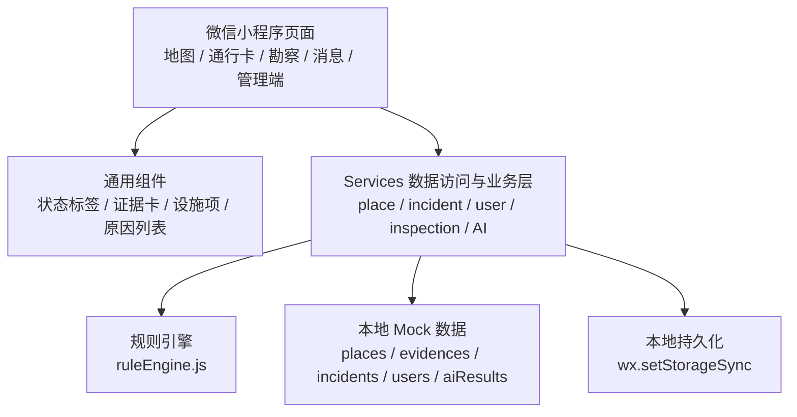
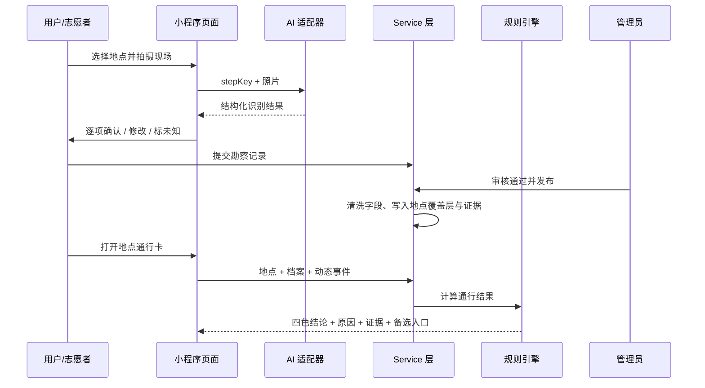
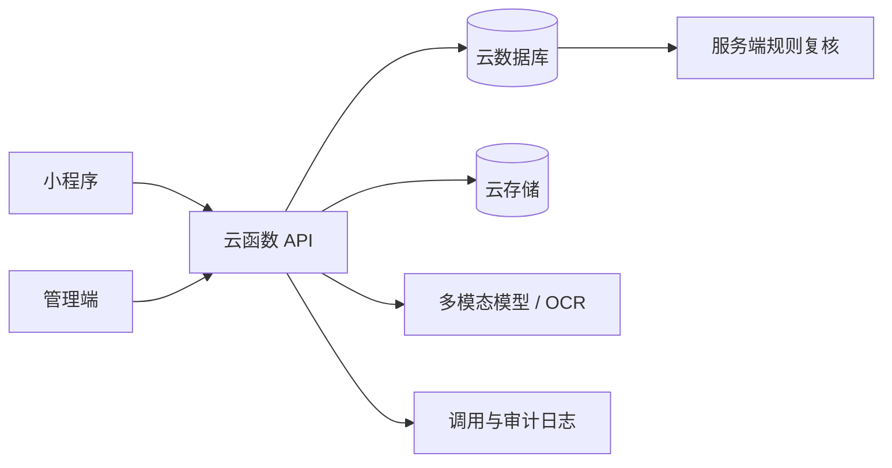

# 系统架构与数据来源

## 1. 分层架构

页面不直接读取 `data/`；统一通过 `services/`。正式接入云开发时只替换 Service 内部实现，页面层不需要重写。

## 2. 核心数据流

## 3. 模块职责

| 模块 | 职责 | 关键文件 |
|---|---|---|
| 页面层 | 交互、空态、错误态、人工确认 | `pages/` |
| 地点服务 | 地点查询、搜索、待勘察任务、覆盖层合并 | `services/placeService.js` |
| 事件服务 | 上报、有效期、过期复核、恢复 | `services/incidentService.js` |
| 用户服务 | 登录、档案、收藏、订阅、最近浏览、已读 | `services/userService.js` |
| 勘察服务 | 提交、审核状态、发布、修订记录 | `services/inspectionService.js` |
| AI 适配器 | 模拟识别、快速检查、调用日志 | `services/aiService.js` |
| AI 契约 | 字段清洗、枚举归一、人工补录标签 | `services/aiSchema.js` |
| 规则引擎 | 根据物理条件与动态事件计算四色状态 | `services/ruleEngine.js` |
| 证据服务 | 现场照片与采信证据集 | `services/evidenceService.js` |

## 4. 数据来源说明

| 数据 | 当前来源 | 性质 | 正式版建议 |
|---|---|---|---|
| 校园中心、类别、有效期 | `data/campus.js` | 示例配置 | 由学校公开资料确认后配置 |
| 5 个地点、入口、设施 | `data/places.js` | 手工构造演示数据 | 实地测量 + 志愿者采集 + 管理员审核 |
| 现场证据 | `data/evidences.js` 与本地转存照片 | 占位图/演示 | 云存储 `fileID` + 采集时间/采集人 |
| 动态事件 | `data/incidents.js` + 本地新增 | 演示事件 | 用户上报 + 管理员复核 + 定时过期 |
| 用户与档案 | `data/users.js` + 本地存储 | 演示账号 | 微信登录、服务端鉴权、档案集合 |
| AI 结果 | `data/aiResults.js` | 预置模拟 JSON | 云函数调用多模态模型，密钥只放服务端 |
| 通行结论 | `services/ruleEngine.js` | 真实规则计算 | 可保留本地即时计算 + 服务端权威复核 |

### 重要声明

- 仓库内地点、事件、账号、AI 结果均为**比赛原型演示数据**，不宣称已经完成真实校园合作或真实覆盖。
- 规则引擎逻辑是真实实现，但它只根据输入数据计算；输入未经验证时，结论只能作为出行准备参考。
- “AI 识别”目前是本地演示适配器，页面已明确标注，不能用模拟结果对外宣称模型准确率。
- 正式材料中的地点数量、用户数量、识别准确率必须来自可追溯的真实采集记录。

## 5. 本地持久化键

| 键 | 内容 |
|---|---|
| `lj_places_over` | 地点字段覆盖层 |
| `lj_places_added` | 新增地点 |
| `lj_incidents_over` | 事件状态覆盖层 |
| `lj_incidents_added` | 新上报事件 |
| `lj_evidences_added` | 新增证据 |
| `lj_inspections` | 勘察记录 |
| `lj_place_revisions` | 发布修订记录 |
| `lj_reviews` | 纠错复核记录 |
| `lj_favorites_by_user` | 按账号隔离的收藏 |
| `lj_subscriptions` | 按账号隔离的地点订阅 |
| `lj_recent_places` | 按账号隔离的最近浏览 |
| `lj_message_reads` | 按账号隔离的消息已读 |
| `lj_profile_over` | 用户档案覆盖层 |
| `lj_ai_logs` | AI 调用日志 |
| `lj_current_uid` | 当前登录用户 |

正式版应把这些本地键迁移到云数据库集合，并把附件迁移到云存储。明文密码只允许存在于演示原型中。

## 6. 正式版目标架构

迁移时保持三个不变量：

1. AI 只预填事实，不能决定通行结论。
2. 人工确认和管理员审核必须留痕。
3. 动态事件过期后必须进入待复核，不能静默消失。
